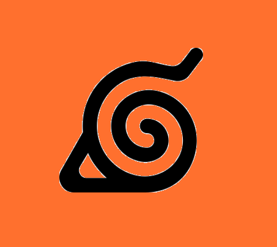
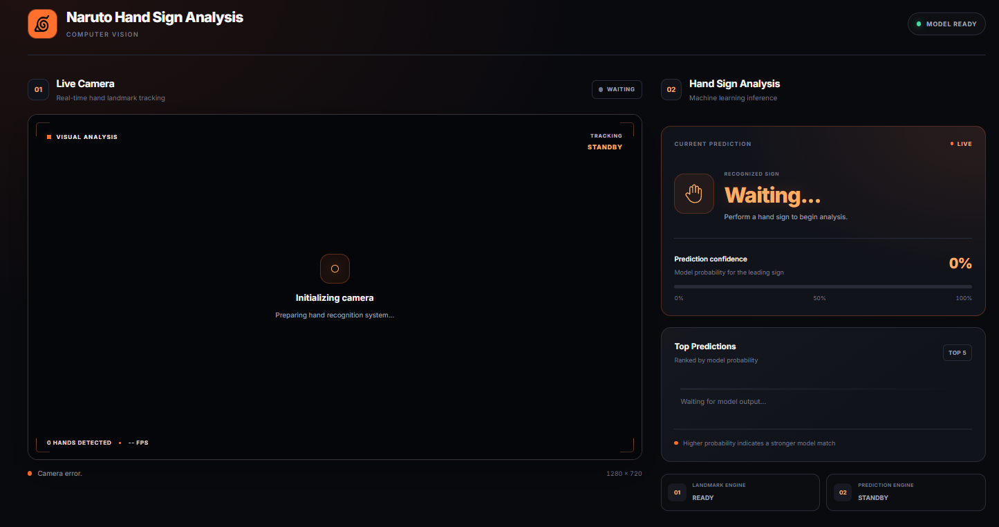

#  Naruto Jutsu CV

A browser-based hand-sign recognition project inspired by the world of Naruto, built with HTML, CSS, JavaScript, Python, and machine learning. The app uses a webcam and MediaPipe-powered hand tracking to classify hand signs in real time and power a simple jutsu experience.

<p align="center">  </p>


</div>

## Overview

Naruto Jutsu CV turns hand gestures into a real-time classification system. It combines:
- webcam-based hand tracking
- feature extraction from hand landmark positions
- a trained machine learning classifier
- an interactive web interface for testing and jutsu simulation

The project is designed as both a fun interactive demo and a practical computer vision project for learning gesture recognition workflows.

## Why this project?

This project demonstrates how to:
- collect and structure hand gesture data
- train a model using scikit-learn
- serve predictions through a Flask API
- connect a Python backend to a browser-based frontend
- build a small AI-powered web experience with live camera input

## Features

| Category | Description |
|----------|-------------|
| **Hand Sign Recognition** | Detects and classifies Naruto-style hand signs from live webcam input. |
| **Model Training Pipeline** | Includes scripts for collecting data, training a classifier, testing performance, and validating the dataset. |
| **Interactive Web App** | Provides a browser UI for testing signs and entering jutsu mode. |
| **Jutsu Simulation** | Lets the user perform a sequence of hand signs to trigger a themed jutsu effect. |
| **Machine Learning Backend** | Uses a trained scikit-learn model served through a Flask API for inference. |
| **Custom Dataset Support** | Allows users to collect new hand-sign samples and extend the model. |

## Tech Stack

- Frontend: HTML, CSS, JavaScript
- Backend: Python, Flask
- Computer Vision: OpenCV, MediaPipe
- Machine Learning: scikit-learn, NumPy, Pandas, Joblib
- Data Processing: CSV-based dataset workflow

## System Architecture

```text
Web Browser
   │
   ├── web/home.html
   ├── web/test.html
   └── web/jutsu.html
         │
         ▼
   JavaScript frontend
         │
         ├── webcam access
         ├── hand landmark processing
         └── API requests to Flask server
                 │
                 ▼
         Python Flask API
                 │
                 └── predict_server.py
                         │
                         ▼
                 Trained model
                 (hand_sign_model.pkl)
```

## Project Structure

```text
naruto-jutsu-cv/
├── dataset/                          # Collected training samples
├── python/
│   ├── collect_data.py               # Collect dataset samples
│   ├── predict_server.py             # Flask prediction server
│   ├── test_model.py                 # Evaluate trained model
│   ├── train_model.py                # Train the classifier
│   ├── validate_dataset.py           # Validate CSV dataset structure
│   └── ...
├── web/
│   ├── css/                          # UI styles
│   ├── images/                       # Icons and visual assets
│   ├── js/                           # Frontend logic
│   ├── home.html                     # Landing page
│   ├── jutsu.html                    # Jutsu challenge mode
│   └── test.html                     # Hand sign recognition tester
├── hand_landmarker.task              # MediaPipe hand landmark model
├── hand_sign_model.pkl               # Trained machine learning model
├── requirements.txt                  # Python dependencies
├── README.md                         # Project documentation
├── .gitignore
└── ...
```

## Getting Started

### Prerequisites

- Python 3.10+
- pip
- A webcam
- Modern web browser

### 1. Clone the repository

```bash
git clone https://github.com/dongantony/naruto-jutsu-cv.git
cd naruto-jutsu-cv
```

### 2. Install dependencies

```bash
pip install -r requirements.txt
```

### 3. Run the prediction API

```bash
cd python
python predict_server.py
```

This starts the Flask server on:

```text
http://127.0.0.1:5000
```

### 4. Launch the frontend

From the repository root:

```bash
python -m http.server 8000
```

Then open:

```text
http://localhost:8000/web/home.html
```

## How to Use

### Hand Sign Test
1. Open the app homepage
2. Click "Hand Sign Test"
3. Allow webcam access
4. Perform a hand sign
5. View the detected label and probability

### Jutsu Mode
1. Open "Jutsu"
2. Choose a jutsu
3. Complete the required hand sign sequence
4. Trigger the jutsu effect when the sequence matches

## Training the Model

To train the classifier on your dataset:

```bash
cd python
python train_model.py
```

This workflow:
- loads all CSV files in the dataset folder
- prepares feature columns
- splits data into train/test sets
- trains a RandomForestClassifier
- evaluates accuracy and confusion matrix
- saves the trained model to `hand_sign_model.pkl`

To evaluate an existing model:

```bash
python test_model.py
```

## Collecting Data

To add new hand sign samples:

```bash
cd python
python collect_data.py
```

Use this to expand the dataset and improve classification accuracy for additional signs and gestures.

## Model and API

The project exposes a prediction endpoint:

```http
POST /predict
```

Example JSON payload:

```json
{
  "features": [0.12, 0.34, 0.56, ...]
}
```

Response:

```json
{
  "prediction": "ramen",
  "probabilities": {
    "clone": 0.02,
    "ramen": 0.94,
    "fireball": 0.04
  }
}
```

Health check endpoint:

```http
GET /health
```

## Future Improvements

Planned enhancements for future versions of the project include:
- Stronger model accuracy
- More jutsus and richer animations/effects
- Better deployment and packaging support

---

*Naruto Jutsu Computer Vision v1 | Antony Dong*
